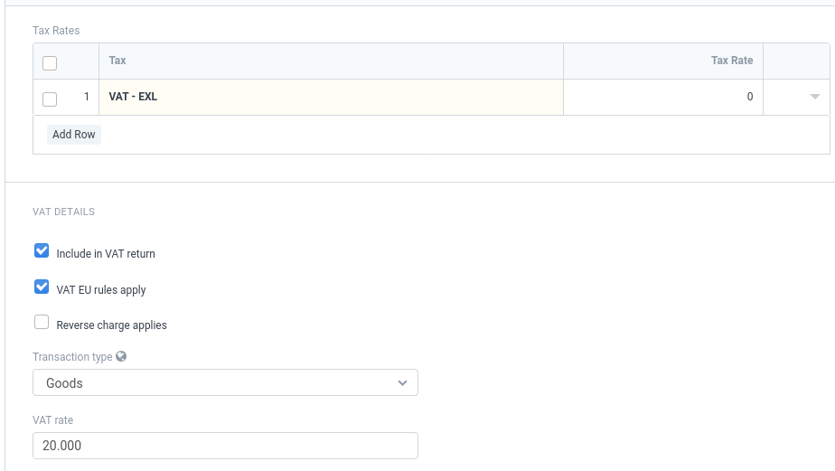
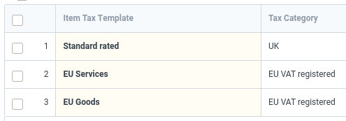
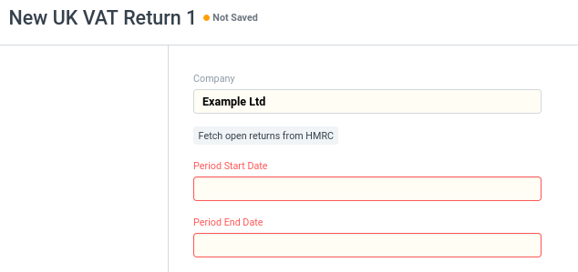
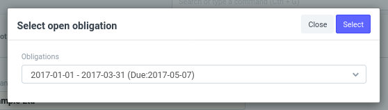
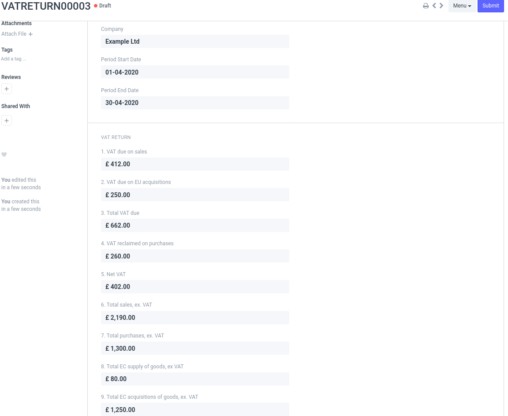
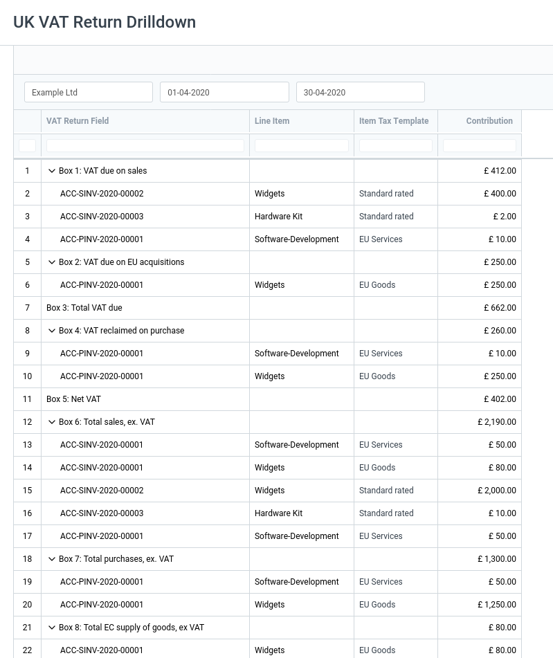
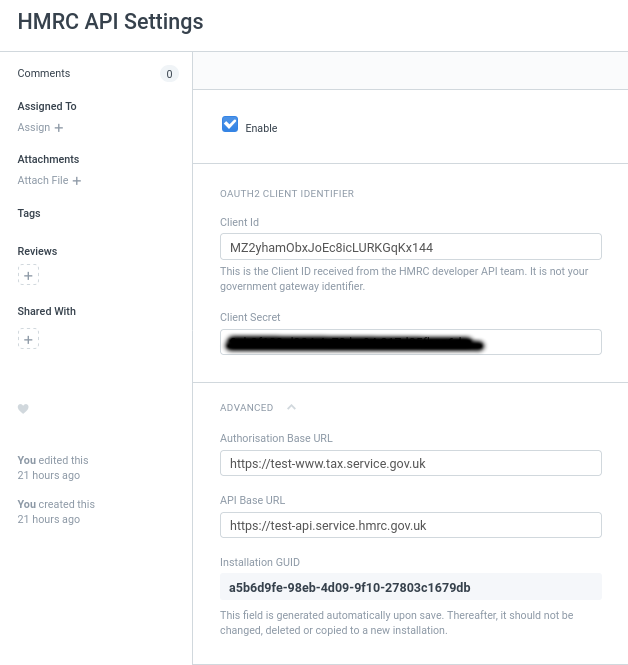
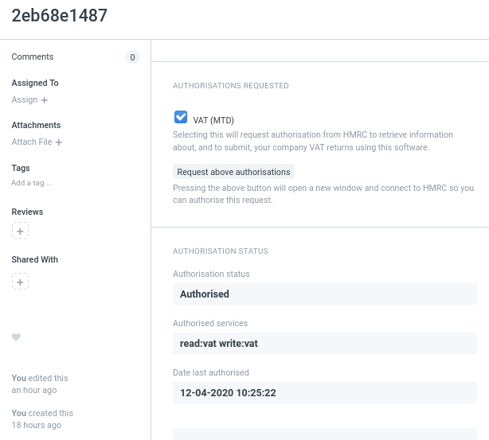

# UK VAT Module

This is RavoLabs Ltd's maintained fork of
[software-to-hardware/erpnext-vat-mtd](https://github.com/software-to-hardware/erpnext-vat-mtd),
used on ERPNext v15. Changes from the original are listed under
[Changes in this fork](#changes-in-this-fork).

The UK VAT module is an application for ERPNext to extend it to include:

 * A VAT Return generator for UK/EU VAT. This uses data from your invoices to automatically
   produce a VAT return;

 * A drilldown report to show the underlying composition of the VAT return; and

 * An optional Making-Tax-Digital submission. (Please note: This feature requires additional
   client credentials from HMRC.)

Raise issues and pull requests for this fork on
[AdamRavo/erpnext-vat-mtd](https://github.com/AdamRavo/erpnext-vat-mtd/issues).

## Installation

This fork targets Frappe and ERPNext v15 and is maintained on the `version-15`
branch. `master` tracks the original repository and is not maintained here.

Install it into an existing bench with:

```sh
bench get-app --branch version-15 https://github.com/AdamRavo/erpnext-vat-mtd
bench --site <your-site> install-app uk_vat
```

For a [frappe_docker](https://github.com/frappe/frappe_docker) custom image, add
it to `apps.json`:

```json
{
  "url": "https://github.com/AdamRavo/erpnext-vat-mtd",
  "branch": "version-15"
}
```

After upgrading to a new version, run `bench --site <your-site> migrate`.

## Configuration of the VAT return

### Overview

The VAT return derives its information from the line items in each invoice, both purchases
and sales.

The line items are linked to "Item Tax Templates" which describe how the VAT return should
process each line item.

Finally, the "Item Tax Templates" can be chosen dynamically, depending on where your customer
is based by linking them to "Tax Categories."

You can use your own "Tax Categories" and "Item Tax Templates" or you can configure them
as described here. To provide maximum flexibility, the VAT Return uses only the
additional data attached to the "Item Tax Templates" and does not rely on fixed
naming or configuration.

### Defining Tax Categories

The "Tax Categories" are applied to customers and suppliers to determine which overall tax
rules to apply to that entity.

For our example installation, we shall refer to three categories:

 * UK
 * EU VAT registered
 * RoW (Rest of World)
 
These categories are not fixed. You are free to define additional categories to suit your
needs.

Define the tax categories in the "Tax Category List." You can get this by searching for it
in the search box at the top of the screen.

### Defining the "Tax Item Templates"

The Tax Item Templates are used to describe the tax rules that apply to individual invoice
line items.

Example Tax Item Templates are:

 * Standard rated
 * Lower rate
 * Exempt
 * Zero Rated
 * VAT does not apply
 * EU Goods
 * EU Services
 * EU Goods (Zero rated)

When you install UK VAT, the "Tax Item Template" is extended so it can hold additional
information describing the rules for your VAT return. An example of this is shown here:



The "Tax Rates" section at the top defines which ledger accounts this
transaction should affect.

The fields in the "VAT Details" section at the bottom define which boxes on
the VAT return will be affected.

You are free to define the categories as you see fit or use existing categories
if you have them.

The original authors configured theirs like this:

| Item Template Name    | Ledger Tax Rate | Include in VAT return? | VAT Rules | Reverse? | Transaction Type | VAT Rate |
|-----------------------|-----------------|------------------------|-----------|----------|------------------|----------|
| Standard Rated        | 20%             | Yes                    | UK        | No       | Not applicable   | 20%      |
| Lower Rate            | 5%              | Yes                    | UK        | No       | Not applicable   | 5%       |
| Exempt                | 0%              | Yes                    | UK        | No       | Not applicable   | 0%       |
| Zero Rated            | 0%              | Yes                    | UK        | No       | Not applicable   | 0%       |
| VAT does not apply    | 0%              | No                     | UK        | No       | Not applicable   | 0%       |
| EU Goods              | 0%              | Yes                    | EU        | No       | Goods            | 20%      |
| EU Services           | 0%              | Yes                    | EU        | Yes      | Services         | 20%      |
| EU Goods (Zero rated) | 0%              | Yes                    | EU        | No       | Goods            | 0%       |
| Reverse Charge Services | 0%            | Yes                    | Rest of World | Yes  | Services         | 20%      |

This example dates from before the UK left the EU. Since 1 January 2021, the EU
rules (Boxes 2, 8 and 9) apply only to goods moving between Northern Ireland and
the EU. Services bought from suppliers outside the UK, including in the EU, use
VAT Rules "Rest of World" with Transaction Type "Services": the reverse charge
goes in Boxes 1 and 4, and the net value in Boxes 6 and 7.

### Applying the Tax Item Templates

The tax item templates are linked to your invoice items by using Item Groups. Using item
groups allows you to apply the Tax Item Templates to a group of items without needing to
visit each one. However, if you need to specialise an item, you can apply a Tax Item Template
directly to it if you wish.

For example, a "services" item group may define the following links:



Note that both EU Service and Goods are defined. The order defines which one is
chosen by default. Having both allows the invoice line items to be customised at the
time the invoice is made to use either. This is required because if service
delivery is a component of goods delivery then for VAT purposes it may need to
be counted as goods for the purposes of the VAT return.

## Generating a VAT return

A VAT return can be generated by searching for "New UK VAT Return" from the search bar.



After selecting your company, if you have configured MTD (described later in
this document) you can press the "Fetch open returns from HMRC" button to select
dates of outstanding VAT returns. 



Otherwise enter the dates manually and save the document to generate the return.

Saving recalculates every box from the submitted invoices in the period. Use
"Save and recalculate" after any invoice in the period is submitted, cancelled
or amended. If invoices in the period have lines with no Item Tax Template,
saving lists them, because those lines are left out of the return.



### VAT return drilldown

To understand how the VAT return is made up, a drilldown report is provided. You
can either access this directly, or by pressing the "Show drilldown" button at the
top of a VAT return.



The report shows each box on the VAT return and then, underneath, which invoice
line-items were used to make up that figure.

### Correcting errors on earlier returns

If the net value of errors on earlier returns is within HMRC's limits
(£10,000, or up to 1% of Box 6 with a ceiling of £50,000; see
[VAT Notice 700/45](https://www.gov.uk/guidance/how-to-correct-vat-errors-and-make-adjustments-or-claims-vat-notice-70045)),
you can correct them on your next return. Open the "Corrections for errors on
earlier returns" section of that return and enter:

 * **Box 1 adjustment**: VAT you under-declared. It is added to Box 1.
 * **Box 4 adjustment**: VAT you over-declared, or input VAT you did not claim.
   It is added to Box 4.
 * **Reason for adjustment**: the return and invoices the correction relates
   to. This is required, and is your record of the error.

Boxes 3 and 5 are recalculated from the adjusted figures. The drilldown report
shows each adjustment as a "Correction of earlier returns" line. Adjustments
above the limits are refused: report those errors to HMRC separately.

## Submitting VAT returns to HMRC

The UK VAT module provides the ability to submit a VAT return electronically to HMRC using
their Making-Tax-Digital (MTD) internet service.

To use this facility an MTD Client Identifier and Secret are required. These are provided
to you by HMRC and are additional to your government gateway id.

The general steps to get this to work are :

 * Setting up the API
 * Authorising your ERPNext installation to access VAT data
 * Submitting your returns

### Setting up the API

To use the electronic submission facility, the API must be enabled and the
Client ID and secret must be entered. You do this by searching for the "HMRC API Settings"
page, selecting "Enable" and entering the required values.



Save the document and press the "Test HMRC Connectivity" button to check the details have
been entered correctly.

#### Using HMRC's test servers

By default, the submission facility targets HMRC's production servers, however,
If you wish to test the submission facility against HMRCs test servers, you can
change the endpoints under the "Advanced" view at the bottom of the page.

### Authorising your ERPNext to access your VAT data

The next step is to obtain an authorisation from HMRC to allow ERPNext to submit VAT returns.
This is achieved electronically, as follows.

1) Go to the HMRC Authorisations List. (search for it.)

2) Create a new authorisation, select your company and save the document.

3) Select the "Request above authorisations" option. This will open a new pop-up window
   (you may need to allow this). Follow the on-screen instructions from HMRC.

When complete, you will be returned to the authorisation document and it should look like
this:



This authorisation is valid (at the time of writing) for 18 months after which you will
need to repeat this step (by pressing the Request above authorisations button) again.

### Submitting your VAT returns

At the bottom of the VAT return page is a submission section for submitting the return
to HMRC.

After agreeing to the declaration, a submit button appears. Pressing it will cause ERPNext
to ask HMRC for a list of outstanding returns. It will then attempt to match the dates of
your VAT return to one of these outstanding obligations. If there is a match, it will then
submit your return.

## Changes in this fork

### 0.1.0

 * Each line's VAT is rounded to the penny, as ERPNext does when it posts VAT,
   so the return agrees with the VAT account.
 * Boxes 1, 2, 4 and 6 to 9 are rounded before Boxes 3 and 5 are derived from
   them. HMRC rejected returns where Box 3 or Box 5 did not match the
   submitted figures exactly. Box 5 is still always positive, as HMRC
   requires.
 * Box 1 and Box 4 adjustments for correcting errors on earlier returns.
 * Submitting recalculates the return first and refuses to send figures that
   are out of date.
 * Saving warns about invoice lines with no Item Tax Template.
 * Invoices are included by posting date whether or not they have been paid.
   The `version-15` branch had limited the return to invoices with status
   Paid, so an invoice still unpaid when its return was saved was never
   declared. Under standard VAT accounting the tax point is the invoice date.
 * Package metadata is in `pyproject.toml`. `setup.py`, `MANIFEST.in` and the
   outdated CentOS 8 installation guide are removed.

## License

GNU/General Public License (see [license.txt](license.txt))

